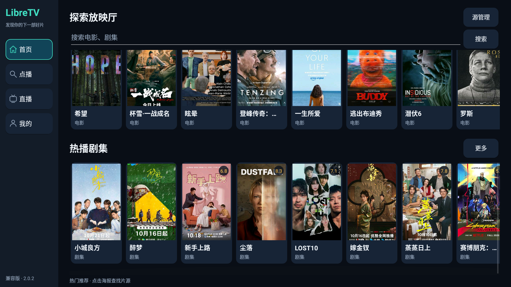
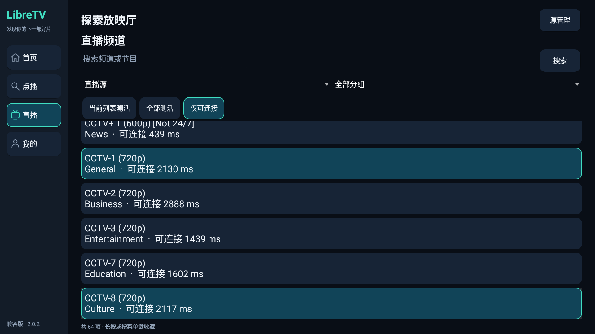
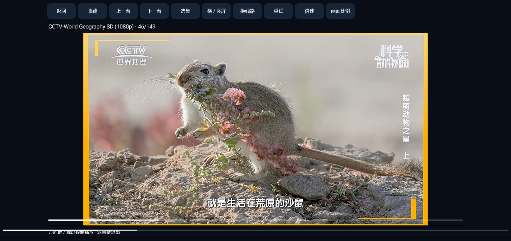

# LibreTV-App

基于 [LibreSpark/LibreTV](https://github.com/LibreSpark/LibreTV) 的**非官方跨平台客户端**。

**Windows 免安装版和 Android 手机 / TV 通用版均已发布。**

| 平台 | 状态 | 说明 |
| --- | --- | --- |
| Windows | 已发布 | Windows 10/11 x64，解压后双击运行 |
| Android | 已发布 | 兼容版 Android 5.0+；新版 Android 8.0+；两版均支持手机和电视 |

## 下载 Android 版

安卓版本：**2.0.2**。两版都支持手机触屏与 Android TV 遥控器，内置 **7 个点播源、9 个直播源**。

| 安装包 | 适用设备 | 下载 |
| --- | --- | --- |
| 兼容版 Legacy | 最低 Android 5.0，推荐 Android 5–7.1 旧设备；包含旧证书库兼容处理 | [下载兼容版 APK](https://github.com/wangshaojie/LibreTV-App/releases/download/android-v2.0.2/LibreTV-App-Android-v2.0.2-legacy-android5.apk) |
| 新版 Modern | Android 8.0 及以上，使用系统 HTTPS 证书库 | [下载新版 APK](https://github.com/wangshaojie/LibreTV-App/releases/download/android-v2.0.2/LibreTV-App-Android-v2.0.2-modern-android8.apk) |

[版本说明与对应源码](https://github.com/wangshaojie/LibreTV-App/releases/tag/android-v2.0.2)。两版使用相同包名和签名，选择适合设备的一版覆盖安装即可，保留源配置、收藏和记录；无需先卸载，同一设备不同时安装两版。

**Android 2.0 已重做界面与主要流程**：海报推荐首页、电影 / 剧集分类、同名聚合搜索、详情与选集、直播分组、源开关和批量测活。手机使用底部导航，电视使用遥控器侧栏与清晰焦点。测活可查看进度、停止、筛选异常并重测，结果会保存在本机。

手机直接下载安装；电视可用 U 盘或电视文件管理器打开 APK。无需 Windows 程序或自建服务器。支持直播、点播、收藏、记录和续播；EPG、离线下载与 Spider/网页解析尚未移植。[完整 Android 说明](android/README.md)。

Windows ZIP 中的源配置已同步更新。已有 Windows 用户可保留个人数据，在源管理的订阅入口添加[最新源列表](https://raw.githubusercontent.com/wangshaojie/LibreTV-App/main/sources/latest.json)。

## Android TV 实机截图

以下截图拍摄于 2026-10-24，来自 Android 5.0.1 电视上的 2.0.2 兼容版。海报、频道和视频画面来自使用时的第三方数据源，仅用于展示客户端界面。

**首页：电影 / 剧集海报、最近观看与遥控器导航**



**直播频道：分组、搜索、批量测活与可连接筛选**



**直播播放页**



## 下载 Windows 版

**[下载 Windows ZIP 包](https://github.com/wangshaojie/LibreTV-App/releases/download/v2.19.2-desktop.2/LibreTV-App-v2.19.2-desktop.2-Windows-x64.zip)** · [查看所有版本](https://github.com/wangshaojie/LibreTV-App/releases)

当前桌面版本：`2.19.2-desktop.2`，基于 LibreTV `2.19.2`。

ZIP 包包含免安装程序、发布者提供的 `LibreTV-Data` 本地数据快照，以及中文使用说明。数据快照保留源配置、设置和观看记录，已排除浏览器缓存、Cookies、日志和运行锁文件。

```text
LibreTV-App/
├── LibreTV.exe
├── LibreTV-Data/
├── 使用说明.txt
├── 更新日志.txt
├── 来源与许可.txt
├── 源码说明.txt
├── LICENSE.txt
└── SHA256.txt
```

## 快速开始

1. 下载 Windows ZIP 包，**完整解压**到有写入权限的文件夹。
2. 双击 `LibreTV.exe`，首次`启动需要解包，请稍等片刻`。
3. 无需另装 Node.js、Docker 或浏览器，也不需要管理员权限。
4. 在「设置 → 源管理」中管理自己的点播源或直播源。M3U 播放列表应添加到**直播源**；Apple CMS JSON API 应添加到**点播源**。
5. 首页用于影片搜索；顶部「直播」用于浏览 M3U 频道和分组。
6. 内置多个直播和点播源

如果要从空白配置开始，首次运行前将随包的 `LibreTV-Data` 移到其他文件夹备份，程序会自动创建全新的数据目录。


点击测活，可是测试所有源中可用频道


## Windows 版功能

- 独立桌面窗口，免安装运行。
- 保留 LibreTV 的聚合搜索、HLS 播放、直播/IPTV、源管理、历史记录和续播功能。
- 内置本地服务，启动时自动登录，关闭程序时停止服务。
- 服务端请求跟随 **Windows 系统代理/PAC**，兼容依赖代理访问的订阅地址。
- 数据保存在 EXE 旁边，方便备份和迁移。
- 支持菜单刷新、全屏、重新登录和打开数据文件夹。

程序仅监听本机回环地址 `127.0.0.1`。它不会自动安装或配置代理软件；网络访问使用当前电脑已有的代理设置。

## 数据、升级和迁移

`LibreTV-Data` 保存源配置、观看记录、设置、浏览器数据和固定本地端口。

- **备份/迁移**：关闭程序，将 EXE 与自己的 `LibreTV-Data` 一起复制。
- **升级**：关闭旧版，仅替换 EXE。不要用发布包里的示例数据覆盖你已经使用的数据目录。
- **同机运行**：避免同时启动多个副本。
- **端口占用**：已有数据目录对应的端口被占用时，关闭占用程序后重试；不要随意修改 `desktop.json`，存储来源改变后原记录可能暂时不可见。

本发布包附带的是发布者的数据快照；数据源和频道状态会随时间变化，请按自己的网络情况管理。

## 网络和播放说明

- 在线内容需要联网，订阅能导入不代表每条线路均可播放。
- 个别频道可能受地区、运营商、服务器状态或编码兼容性影响。
- 如果订阅地址依赖代理，请确保本机的系统代理和代理软件正常工作。
- 出错时可查看 `LibreTV-Data/desktop.log`；提交问题前请自行检查并隐去日志中的私人地址或令牌。
- 当前构建未做代码签名，Windows 可能显示发布者未知。

Windows 当前提供 x64 程序，Windows 7、32 位和 ARM 原生版本未提供。Android 已发布独立 APK，下载链接见本文顶部。

## Android 通用版

Android 手机 / TV 通用版 **2.0.2 已正式发布**，提供兼容版（Android 5.0+）和新版（Android 8.0+）两个签名 APK。已完成四组手机 / TV 模拟设备验证，并在 Android 5 实机电视上验证遥控器点播流程。

支持海报推荐首页、电影 / 剧集分类、Apple CMS 全源搜索、详情选集、M3U 直播、批量测活、收藏、续播及配置导入导出；无需连接 Windows 或搭建服务器。2.0.2 修复了搜索结果海报高亮后，遥控器确认键无法打开详情的问题；同时保留视频直连优先和换线路入口。

- [下载 Android 5.0+ 兼容版](https://github.com/wangshaojie/LibreTV-App/releases/download/android-v2.0.2/LibreTV-App-Android-v2.0.2-legacy-android5.apk)
- [下载 Android 8.0+ 新版](https://github.com/wangshaojie/LibreTV-App/releases/download/android-v2.0.2/LibreTV-App-Android-v2.0.2-modern-android8.apk)
- [使用、构建与功能说明](android/README.md) · [最新版本说明与源码](https://github.com/wangshaojie/LibreTV-App/releases/tag/android-v2.0.2)

## 从源码构建 Windows 版

在 Windows x64 上使用 Node.js 22 或更新的受支持版本；本次构建使用 Node.js 24.15.0。

```powershell
npm ci
cd desktop
npm ci
npm run dist
```

输出文件：

```text
desktop/dist/LibreTV-2.19.2-desktop.2-Windows-x64-Portable.exe
```

构建过程需要联网下载依赖。打包使用 Electron 和 electron-builder，源码归档使用 Windows 自带的 `tar.exe`。更多开发与验证说明见 [desktop/README.md](desktop/README.md)。

Releases 同时提供与已发布程序对应的源码 ZIP。Windows 下载包中的本地数据属于单独提供的运行数据，不纳入 Git 源码历史。

## 上游与开源许可

本项目是非官方衍生项目，原项目及原作者的贡献和署名予以保留。

- 上游项目：[LibreSpark/LibreTV](https://github.com/LibreSpark/LibreTV)
- 上游版本：`2.19.2`
- 基础提交：`dd1c744c40d60ee553bd9f7eb3df55dd79a8f7dc`
- 原项目说明：[README.upstream.md](README.upstream.md)
- 本仓库增加：Windows 便携封装、系统代理网络适配、Android 手机 / TV 原生客户端、批量测活、构建/验证脚本和发布文档。
- 桌面封装修改日期：2026-10-17；Android 实机截图与发布文档更新日期：2026-10-24。

LibreTV 和本项目按 **AGPL-3.0-or-later** 提供，完整条款见 [LICENSE](LICENSE)。Electron、Chromium 及其他第三方组件遵循各自许可证。

本项目提供客户端和播放功能，不制作或托管影视内容。请仅使用有权访问的数据源和内容。
