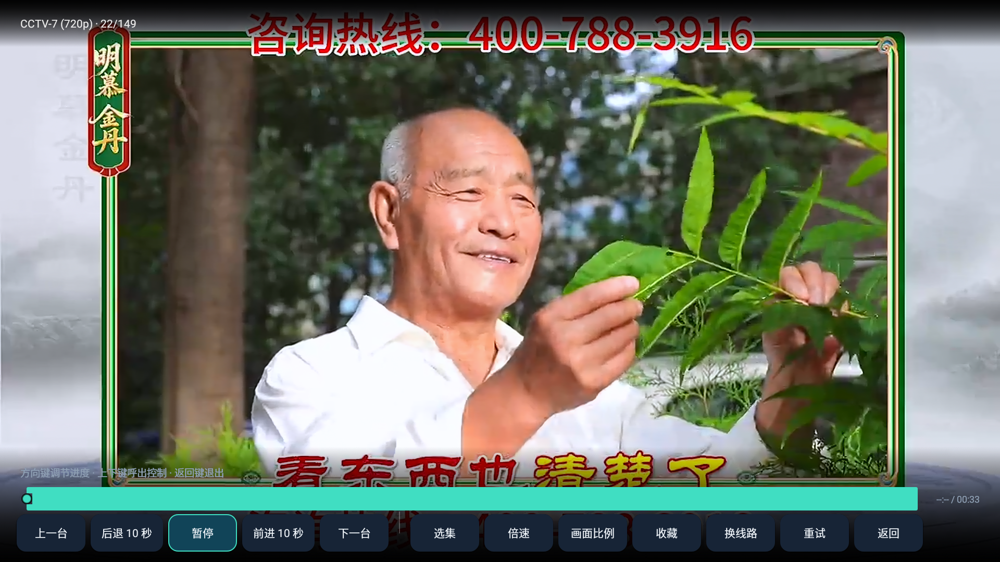

# 静观 TV（Android）

原生 Android 客户端，**支持手机和 Android TV**。应用名 **静观 TV**，包名 `com.wangshaojie.libretv`，版本 `2.0.14`。最低 Android 5.0 / API 21，手机与电视使用同一个安装包。

Android 8.0 以下的系统会加载内置的 Mozilla / certifi 根证书以补齐旧系统缺失的现代 CA，确保片源站点的 HTTPS 订阅读取成功；Android 8.0 及以上直接使用系统证书库。应用始终验证证书链和主机名，不修改系统证书、不跳过校验。根证书来源、固定提交与许可见 APK 的 assets/ca-bundle-source.txt。

2026-10-25 更新内置源至 9 个点播源（新增「魔都动漫」「樱花资源」）、9 个直播源。1.0.0 用户覆盖安装后会自动补入新增源，按类型与地址去重，仅执行一次，不覆盖个人源、收藏和历史。

## 下载与安装

- [Android 5.0+ 通用版 APK](https://github.com/wangshaojie/LibreTV-App/releases/download/android-v2.0.14/LibreTV-App-Android-v2.0.14-universal-android5.apk)
- [发布说明、源码和校验文件](https://github.com/wangshaojie/LibreTV-App/releases/tag/android-v2.0.14)

手机直接下载安装，电视可用 U 盘或电视文件管理器打开 APK；系统弹出「允许安装未知来源应用」时选择允许即可。手机桌面和电视桌面均有启动入口；手机播放页的控制面板里可切换横 / 竖屏，电视采用横屏和明显的焦点边框。覆盖安装保留数据。

直播源填写 M3U 列表地址，点播源填写 Apple CMS JSON API。HTTP IPTV 流可以播放；HTTPS 仍正常验证证书。网络请求遵循 Android 的网络环境 / 系统代理配置，具体连通性取决于当前设备。无需 Windows 程序、Docker、Node.js 或自行搭建服务器，也不会请求通讯录、摄像头、定位或全盘存储权限。

### 版本要点

- **2.0.14** 让「更新通道」和「代理能力」都按用户实际情况工作：官方片源清单改为多地址（GitHub Raw 为主，另备 jsDelivr 等镜像），主地址拉不到就依次换镜像，全都拉不到才沿用本地配置——电视这类没有代理的设备也能持续收到后续的源更新。自建 IPv4 通道现在与正常请求一样尊重系统 HTTP 代理，配了代理的设备不会再出现「正常请求走代理、回退请求绕过代理」的情况。源管理里的状态会同时写出两段原因（例如「IPv6 不可达（…），IPv4 直连也失败：…」），便于分清是源的问题还是网络的问题。
- **2.0.13** 网络层统一走一条通道：老电视只有链路本地 IPv6 时，改为自建连接直连该主机的 IPv4 地址，同时保持正确的 SNI 与证书校验（此前用 IP 直连会丢掉 SNI，Cloudflare 站点会拿默认证书回应）；Android 8.0 以下默认只协商 TLS 1.0，本版补上 TLS 1.1/1.2，服务器支持就用高版本，不支持仍回落 TLS 1.0。测活与海报加载也改用同一条通道，源管理里的「可连接 / 连接异常」不再与应用内实际表现不一致。官方片源清单新增「魔都动漫」「樱花资源」两个动漫向点播源。
- **2.0.12** 合并为单一通用安装包：此前分发的「兼容版」与「新版」功能完全一致，现合为一个 APK，最低 Android 5.0，手机与电视通用，桌面图标统一为「静观 TV」。证书补丁按系统版本自动启用——Android 8.0 以下补齐根证书库，8.0 及以上用系统证书库。
- **2.0.11** 详情页里直接换片源：影片详情页简介下方新增「片源 · N 个可用」一行，当前片源高亮，点一下即切换，标题行、收藏状态、线路与剧集都跟随更新，不再需要「选择片源」弹窗；只有一个片源时不显示该行，剧集不跨片源合并。同时修正 2.0.10 的连接改动：改为默认按域名连接，仅在确认 IPv6 不可达时才改用 IPv4 重试。
- **2.0.10** 修复部分老电视连不上网的问题：这类电视所在路由器会返回 IPv6 地址，但电视没有 IPv6 路由，Android 5.0 底层又不回退到 IPv4，导致所有带 AAAA 记录的站点都连不上。（2.0.11 已改正该做法。）
- **2.0.9** 新增官方片源清单：启动时自动获取项目维护的源清单并合并到本地配置——新增的源自动补入、手动停用的源保持停用、你自己添加的源不受影响、删除过的官方源不会被加回；也可在「源管理 → 官方清单」手动刷新。清单地址由维护者控制，用户无法改写。
- **2.0.8** 连接中的播放页不再是一片黑屏：控制面板会先显示并提示「正在连接…」，开始播放后自动淡出。
- **2.0.7** 应用更名为静观 TV，图标沿用原来的 LibreTV 渐变字母 L；包名、签名和下载地址不变，可直接覆盖升级。
- **2.0.6** 直播播放遇到「落后于直播窗口」时自动重新接入直播边缘并继续观看，不用手动按「重试」。
- **2.0.5** 播放页改为全屏沉浸式：画面铺满屏幕，观看时不显示常驻按钮与标题。
- **2.0.4** 切台与换线路改为复用同一播放器，不再销毁重建电视的硬件解码器；同时解码失败时给出可读提示，并修复部分 Android 版本上回车键无法打开海报详情。

### 实机截图

2026-10-24 实机截图（Android 5.0.1 电视）。2.0.7 起应用改名为静观 TV，界面除品牌文字外没有变化：




## 常见问题：只有声音没有画面

部分早期电视（Android 5–7）只有硬件视频解码器，没有软件解码器兜底。以下情况会出现「有声音、画面全黑」：

- 电视的硬件解码器进入异常状态（多见于连续切台、换线路之后）。
- 码流编码超出该芯片的解码能力，例如清晰度过高或编码方式不常见。

处理顺序：

1. 在播放页呼出控制面板后按「重试」，应用会重建解码器再试一次。
2. 返回详情点「换线路」换一条线路，或在直播列表选择更低清晰度的频道（例如标有 576p / SD 的同名台）。
3. 若电视上所有视频都只有声音没有画面，请重启电视：断电 10 秒再开机（或在系统设置里重启），电视的视频通路会重新初始化。

2.0.4 起切台与换线路不再销毁重建解码器，早期电视上这类崩溃与「只剩声音」的连锁故障可以避免。若已经出现所有视频只有声音没有画面，请重启电视（断电 10 秒再开机）恢复。

## 播放页：全屏沉浸式

2.0.5 起播放页是纯粹的画面：视频铺满整块屏幕，观看时不显示顶部按钮、标题或状态栏。

- 呼出控制：手机点一下画面；电视按上 / 下键或菜单键。
- 连接期间：控制面板会先显示出来并提示「正在连接…」，不会只剩一片黑屏；开始播放后约 4 秒自动淡出。切换频道、换集、点「重试」都是同样的表现。
- 面板内容：进度条与时间、上一集 / 下一集、后退 / 前进 10 秒、播放暂停、选集、倍速、画面比例、横竖屏（仅手机）、收藏、换线路、重试、返回。
- 收起控制：再点一次画面，或按返回键（第一次返回只收起面板，再按一次才退出播放页）。
- 面板在无操作约 4 秒后自动淡出；标题单独淡入淡出，观看时始终只留画面。
- 面板隐藏时：左右键快进 / 快退 10 秒（画面中央短暂提示），确定键播放 / 暂停，遥控器频道键切台。
- 媒体键（播放 / 暂停 / 上下曲 / 快进快退）保持可用，与系统播放器一致。

## 直播：自动重新接入直播边缘

2.0.6 起，直播流因为网络抖动或落后于滑动直播窗口而中断时，应用会自己重新接入直播边缘并继续观看：

- 触发条件：直播源播放中断（落后于直播窗口、网络连接失败 / 超时、服务器返回异常状态等）。
- 行为：画面中央短暂提示「正在重新接入直播…」，随后自动重新拉流并继续播放，不需要手动按「重试」。重连时不弹出标题栏和控制面板。
- 保护：两次自动重连至少间隔 20 秒，连续失败 3 次后停止自动重连并给出提示，避免无限重试占用带宽。重新接入成功即重新开始计时。
- 点播内容不受影响：点播仍按原来的错误提示处理，方便换线路或选择更低清晰度的源。

## 功能

- **首页**：浏览推荐、最近观看；推荐来源可切换为豆瓣或已启用 CMS 源，推荐失败时使用缓存或片源数据。
- **点播**：电影 / 剧集分类，Apple CMS JSON 多源搜索、同名影片合并、原生详情与选集、线路切换；详情页内直接列出全部片源并可一键切换。
- **直播**：M3U / M3U8 订阅导入、节目搜索、分组筛选、上一台 / 下一台。
- **我的**：收藏、最近观看、点播续播，源配置 JSON 导入 / 导出与配置备份。
- **官方源清单**：启动时自动获取项目维护的片源清单（超过 6 小时才再次请求），新增的源自动补入、手动停用的源保持停用、自己添加的源不受影响、删除过的官方源不会被加回；也可在「源管理 → 官方清单」手动刷新。清单地址由维护者控制，用户无法改写。
- **源与频道测活**：「源管理 → 全部测活」检测片源，「直播 → 当前列表测活 / 全部测活」检测频道。可停止、筛选异常及重测，结果回写本机。
- **导航**：手机采用底部导航与触屏操作；Android TV 采用侧栏与遥控器焦点，方向键移动焦点、确定键操作、返回键退出、菜单键 / 长按收藏。
- **播放**：Media3 / ExoPlayer 原生 HLS、DASH、MP4，支持直播与自动下一集。

同一 APK 不含 CPU 专用原生库，可在常见 ARM32、ARM64、x86、x86_64 设备安装；实际解码能力取决于设备。初始源来自此前 Windows 公开下载包中发布的配置，Android 数据存于应用私有目录，不与 Windows 的浏览器数据库直接共享。

注：点播首页的 Spider/网页源文字原为固定能力说明，2.0.4 已改成正常搜索引导，无需据此更换内置点播源。详情使用与 Windows 端一致的 videolist API。

这是独立原生实现，沿用 LibreTV 的源协议和使用方式。EPG、Spider/网页解析、离线下载和 Windows 版的全部高级功能尚未移植。程序不提供影视内容，不保证第三方线路可用。

[完整功能表](FEATURES.md) · [隐私说明](PRIVACY.md)

## 构建与签名

使用 JDK 17、Gradle 8.9、Android SDK 35：

```sh
gradle -p android testDebugUnitTest assembleDebug
```

正式包通过 `.github/workflows/android-release.yml` 构建。仓库 Secrets 中保存 `ANDROID_KEYSTORE_BASE64` 和 `ANDROID_KEYSTORE_PASSWORD`，签名别名 `libretv-app`。签名密钥不会提交到 Git 或放入下载附件；必须保留相同密钥才能覆盖安装后续版本。

工作流运行单元测试、Lint，以及 Android 5 手机（API 21）和 Android TV（API 28）两组设备测试，覆盖首页、搜索、HTTP 播放、选集收藏、批量测活、取消、数据持久化和证书校验，并导出截图用于布局检查。通过后发布签名 APK。界面测试使用本地合成片目和视频，测试数据不会进入正式安装包。

## 许可与来源

基于 LibreSpark/LibreTV 的非官方客户端，Android 端名为静观 TV。原生实现修改日期：2026-10-24。项目继续使用 AGPL-3.0-or-later；原许可证见根目录 LICENSE，应用内也包含完整许可证。Media3/ExoPlayer 遵循 Apache-2.0，其他组件遵循各自许可证。
