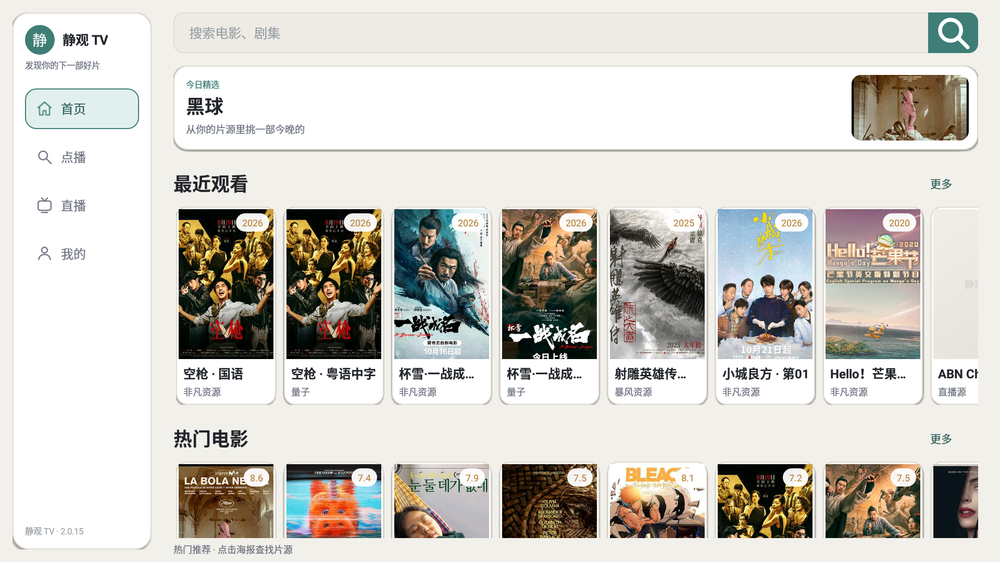
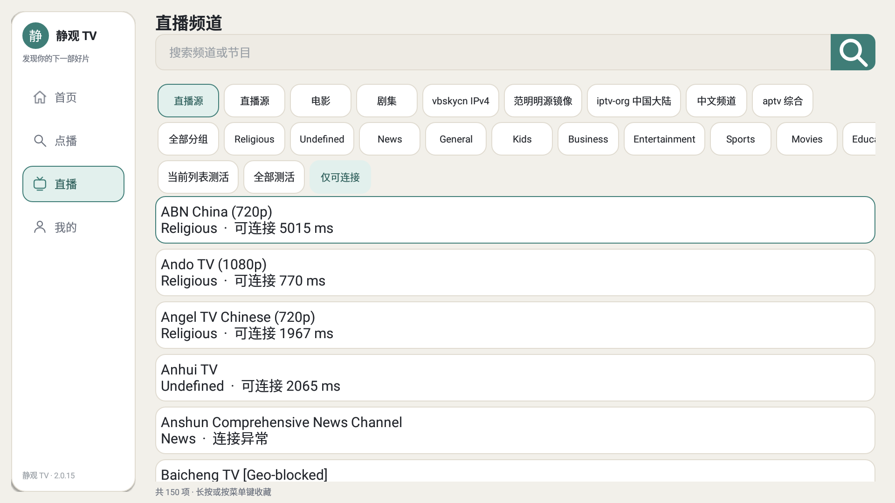
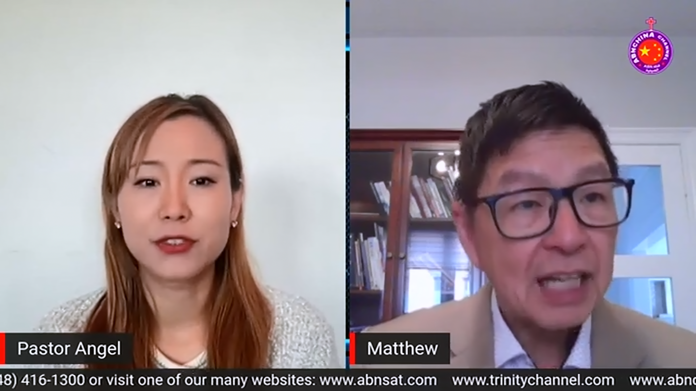
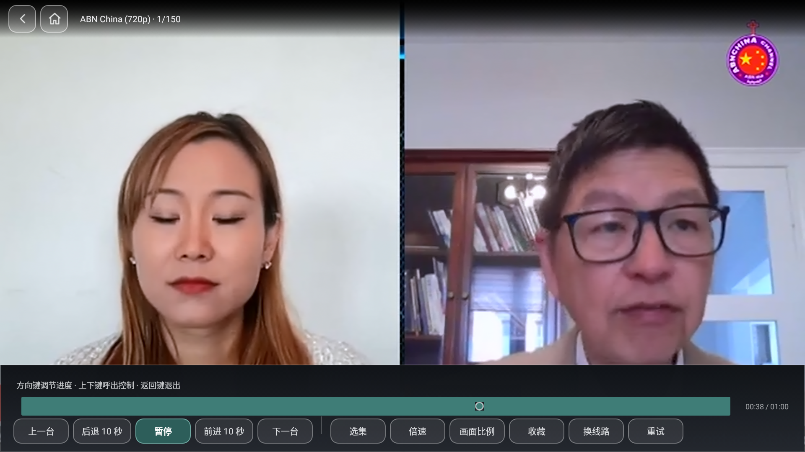
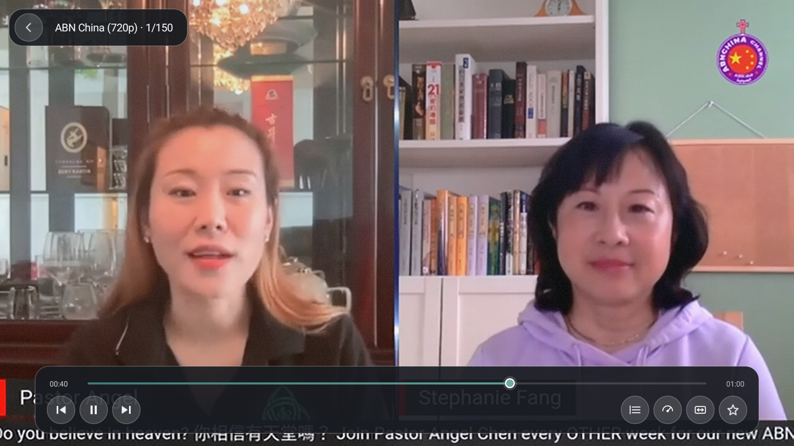

# 静观 TV（Android）

原生 Android 客户端，**支持手机和 Android TV**。应用名 **静观 TV**，包名 `com.wangshaojie.libretv`，版本 `2.0.18`。最低 Android 5.0 / API 21，手机与电视使用同一个安装包。

Android 8.0 以下的系统会加载内置的 Mozilla / certifi 根证书以补齐旧系统缺失的现代 CA，确保片源站点的 HTTPS 订阅读取成功；Android 8.0 及以上直接使用系统证书库。应用始终验证证书链和主机名，不修改系统证书、不跳过校验。根证书来源、固定提交与许可见 APK 的 assets/ca-bundle-source.txt。

2026-10-25 更新内置源至 9 个点播源（新增「魔都动漫」「樱花资源」）、9 个直播源。1.0.0 用户覆盖安装后会自动补入新增源，按类型与地址去重，仅执行一次，不覆盖个人源、收藏和历史。

## 下载与安装

- [Android 5.0+ 通用版 APK](https://github.com/wangshaojie/LibreTV-App/releases/download/android-v2.0.15/LibreTV-App-Android-v2.0.15-universal-android5.apk)
- [发布说明、源码和校验文件](https://github.com/wangshaojie/LibreTV-App/releases/tag/android-v2.0.15)

手机直接下载安装，电视可用 U 盘或电视文件管理器打开 APK；系统弹出「允许安装未知来源应用」时选择允许即可。手机桌面和电视桌面均有启动入口；手机播放页的控制面板里可一键全屏（再点一次画面退出），电视采用横屏和明显的焦点边框。覆盖安装保留数据。

直播源填写 M3U 列表地址，点播源填写 Apple CMS JSON API。HTTP IPTV 流可以播放；HTTPS 仍正常验证证书。网络请求遵循 Android 的网络环境 / 系统代理配置，具体连通性取决于当前设备。无需 Windows 程序、Docker、Node.js 或自行搭建服务器，也不会请求通讯录、摄像头、定位或全盘存储权限。

### 版本要点

- **2.0.23** 三件事。**① 电视端长按左右键现在真的比点按快**。以前按住不放是恒定的「每 0.25 秒走 3 秒」，折合 12 秒/秒 —— 跟点按一次的 10 秒几乎没差别，看着画面在动，其实不快，用户想跳过片头片尾还是得一直按着、按三秒也只多走二十几秒。现在改成**越按越快**：按住 0~1.5 秒每 0.2 秒走 5 秒（25 秒/秒），按住 1.5~4 秒每 0.2 秒走 8 秒（40 秒/秒），按住超过 4 秒每 0.15 秒走 12 秒（80 秒/秒）—— 想跳就多按一会儿，松手立刻停，画面中央还会提示当前档位（加速 ×2 / ×4 / ×8）。点按仍是稳的 10 秒，不受影响。**② 长按的三个毛病一起修掉**：以前按住超过 8 秒，控制区会被「空闲自动隐藏」收走 —— 面板连同焦点一起被摘走，于是松手那个按键事件走不到收尾逻辑，**定时器就一直快进到视频结束**。现在按主流播放器（B 站 / 爱奇艺 / YouTube）的做法：**长按期间控制区常驻**（每跳都重排空闲计时，屏幕一直看得见进度条在动）、**松手必停**（左右键抬起时无条件收尾，跟面板可见性、焦点位置都无关）、**快到片尾自动停**（不会把播放位置钉在片尾），切集、重连、暂停、退出播放页也都会顺手把长按收掉。**③ 手机端播放页补上了播放 / 暂停键**。以前画面上单击只是呼出控制面板，面板里能选集、能倍速、能收藏，唯独不能暂停，想停一下得退回上一级 —— 现在图标行最左边就是播放 / 暂停键，图标跟着播放状态自动在「播放」和「暂停」之间切换，点一下即可暂停或继续。手机端六个图标键统一缩到 42dp，竖屏一行排得下不挤边。
- **2.0.22** 修掉电视端「**从观看记录点进去只有一集**」的毛病。以前的路径是：观看记录里存的是你**看过的那一集**（带着播放地址），点开时应用看到有地址就直接播这一条 —— 于是播放页的剧集列表里只有一条，按「下一集」必然提示「没有更多剧集」。从推荐 / 搜索进去就正常，是因为那条路会经过详情页，详情页会重新拉一次整部剧的剧集列表。现在从观看记录打开点播也会**重新拉一次全集**：记录里带编号的直接按编号取全集；老版本记下的记录没有编号（vodId 为空），就按片名（标题里「·」之前的剧名）搜一次、挑最接近的一部再取全集。取到了就直接进播放页、并且**停在你原来看到的那一集**（先按播放地址对，对不上再按集名对，再不行从第 1 集开始）；源临时挂了取不到全集，就退回单集并提示「没取到这部剧的剧集列表，先看这一集」，不会卡在加载不出来。播放逻辑一行未改，遥控器操作照旧。另外把剧集条目里的编号、线路一并写进观看记录，新记的记录下次就能秒开，不用再走「按片名搜」这条兜底路。
- **2.0.21** 修掉电视端播放页的一个硬毛病：**在控制区里按了「下一集」之后，遥控器就失灵了** —— 方向键按下去一点反应都没有，画面也没有任何变化，非得先按返回把控制区收起来、再用方向键唤出来才能恢复。原因是焦点在控制区隐藏时被一起带走了：播放页的焦点全部是自绘的（进度条 / 按钮行 / 标题栏三段），控制区淡出时整个面板会被 `setVisibility(GONE)` 摘掉，**正带着焦点的进度条也跟着一起消失，焦点当场变成空**；焦点一旦为空，方向键就找不到可以移动的起点，最后交给系统的默认焦点搜索，而这套两行面板的布局它多半什么也找不到 —— 于是「按什么都没反应」。现在做了五件事：**① 控制区隐藏之前先把焦点挪到根容器**，不再有「面板一隐藏焦点就变空」；**② 焦点为空时，任何方向键都会先把焦点抢回进度条再继续处理**（空焦点变成可自愈的状态）；**③ 进度条拿不到焦点时退到播放键**，焦点绝不留空；**④ 切集连上之后重新排一次空闲隐藏计时**，控制区不再一直挂在屏幕上；**⑤ 焦点搬走之后重新排计时** —— 之前那次排的是「搬之前」的时长，用户刚从按钮行挪到进度条，本该按 8 秒算却还挂着按钮行的 16 秒双倍缓冲，控制区迟迟不隐藏。播放逻辑一行未改。另外播放页加了一行焦点日志（`adb logcat -s LibreTV-Player`），下次再出焦点问题可以直接还原现场。
- **2.0.19** 整个界面改成**扁平风**，和网页端、桌面端统一。以前的层次靠「白卡 + 一圈淡描边 + 一层柔和投影」叠出来，看着精致但显脏，而且在一台十年前的电视上，那些投影和毛玻璃还会让画面发糊。现在这些全部去掉：**没有阴影、没有装饰描边、没有大圆角、没有渐变**，层次只靠纯色块的深浅区分（页面底 → 面板底 → 卡片 → 标签四级色阶）。焦点态也跟着换：描边被去掉后如果还靠描边提示焦点，在浅底上几乎看不见，所以改成**实心色块** —— 带文字的控件聚焦时铺一层淡青底，图标按钮聚焦时铺深青底配白图标，遥控器扫过去一眼就知道停在哪。播放页那套「暗夜毛玻璃」也整个废弃了：环境光渐变、胶片颗粒、半透明玻璃卡片、亮边描边全部去掉，控制面板改成一块**不透明的深色直角块**，标题、图标键、进度条都是纯色直角，屏幕更干净。弹框也改成直角纯色面板，不再是圆角描边风。**播放逻辑一行未改**：遥控器方向键、快进快退、进度条、选集、倍速、画面比例、收藏、换线路、错误重试全部照旧，遥控器的焦点摆放也没动 —— 这次只改长相，不改操作。
- **2.0.18** 观看记录和搜索记录**都能删了**。以前「我的 → 观看记录」只能看不能清，看过的片子越积越多，想删一条只能卸载应用重来。现在：观看记录页标题右边多一个「**清空记录**」按钮，一键清掉全部记录（连同各自的续播进度一起清掉，不会留下「记录没了但进度还在」的半吊子状态）；删除**单条**则是**长按卡片**（电视上按遥控器**菜单键**）调出菜单，选「删除此记录」。点播页的「最近搜索」同理：长按单个词删掉那一条，或者点「**清空搜索记录**」全部清掉。所有删除动作都会先弹确认框，而且**焦点默认落在「继续浏览」上** —— 遥控器按一次确定键不会误删。网页端也补上了同一件事：历史面板里的删除按钮以前只在鼠标悬停时出现，手机浏览器上根本点不到，现在触屏设备上常显。
- **2.0.17** 修掉电视端遥控器在播放页上的三个硬毛病：**没法快进**、**焦点走到进度条就再也走不到后面的按钮**、以及**控制区永远压在画面上不消失**。原因是控制区把进度条和按钮混在同一条横排里，焦点一落到进度条上，左右键就被系统 SeekBar 吃掉 —— 它只改自己的刻度、不会真的让画面快进，焦点也就被困在那儿了。现在控制区改成上下两行：**上行是进度条（当前时间 + 进度条 + 总时长）独占一行**，下行才是上一集 / 播放暂停 / 下一集 与选集 / 倍速 / 画面比例 / 收藏。遥控器操作随之调整：**一进播放页焦点就落在进度条上**，直接按左右键即可快进 / 快退 10 秒，按住不放会连续加速（每 0.25 秒再走 3 秒），松手停在当前时间；**上下键**在「进度条 ↔ 按钮行 ↔ 标题栏返回键」之间搬焦点；**左右键**在按钮行里逐个走过每个功能键（不再有按键被吞、也不再一次跳两格）。进度条获得焦点时滑块明显变大变亮，一眼能看出焦点在哪。另外控制区不再常驻：**无操作约 8 秒后自动淡出**，画面保持干净，按任意方向键即可唤回（唤回时焦点直接在进度条上）；正在连接流、或播放出错需要按「重试」时控制区不会自动隐藏。手机端排版与操作不变。
- **2.0.16** 播放页重做，两端各按各自的使用习惯排版，并换成「暗夜毛玻璃」视觉体系。**电视**：控制区收成一条横排 —— 上一集 / 播放暂停 / 下一集 在左，进度条（当前时间 + 进度条 + 总时长）居中，选集 / 倍速 / 画面比例 / 收藏在右，全部是图标键，不再是一排「上一台 / 后退10秒 / 暂停 / 下一台 / 选集 / 倍速 / 画面比例 / 收藏 / 换线路 / 重试」的文字按钮；遥控器方向键在图标间移动，焦点框是明显的青绿描边；**控制区常驻不自动隐藏**，遥控器随时找得到功能键。**手机**（爱奇艺式）：进度条独占一行，下面一排选集 / 倍速 / 画面比例 / 收藏 / 全屏；点画面呼出收起，双击画面左半边快退 10 秒、右半边快进 10 秒，横向拖动连续调进度并显示目标时间。视觉上：控制区不再贴着屏幕下沿，而是底部悬浮的一块半透明玻璃卡片（大圆角 + 细浅色描边 + 柔和投影），标题缩成左上角一枚玻璃胶囊，图标键是圆形玻璃底，进度条是 3px 细线、已播部分走青绿渐变，画面上叠一层极淡的胶片颗粒。播放逻辑一行未改：直播自动重连、错误提示、播放器实例复用、返回键三级链都照旧。
- **2.0.15** 把手机端整个重做了一遍：界面换成浅色单主题（暖白底 + 单一青绿强调色），一级页面去掉顶栏，弹框全部自绘。修掉三个手机端的老毛病 —— 按钮「要点两下」才响应（按设备类型分流触摸模式聚焦，手机点一下即执行，电视遥控器行为不变）、详情页切源后旧请求盖掉新源的线路、Android 15 上一点开就闪退（取键盘高度的新接口在键盘不可见时抛异常，现在先判断是否可见）。播放页控制条上的「横 / 竖屏」换成「全屏」：点一下切横屏并收起所有控件，再点画面切回竖屏，返回键也能先退全屏。Android 15 全面屏下的底部导航适配同步完成。另外应用会把崩溃现场记到本地，万一再异常退出，下次启动会弹「异常记录」框显示堆栈，截图反馈即可定位。
- **2.0.14** 让「更新通道」和「代理能力」都按用户实际情况工作：官方片源清单改为多地址（GitHub Raw 为主，另备 jsDelivr 等镜像），主地址拉不到就依次换镜像，全都拉不到才沿用本地配置——电视这类没有代理的设备也能持续收到后续的源更新。自建 IPv4 通道现在与正常请求一样尊重系统 HTTP 代理，配了代理的设备不会再出现「正常请求走代理、回退请求绕过代理」的情况。源管理里的状态会同时写出两段原因（例如「IPv6 不可达（…），IPv4 直连也失败：…」），便于分清是源的问题还是网络的问题。
- **2.0.13** 网络层统一走一条通道：老电视只有链路本地 IPv6 时，改为自建连接直连该主机的 IPv4 地址，同时保持正确的 SNI 与证书校验（此前用 IP 直连会丢掉 SNI，Cloudflare 站点会拿默认证书回应）；Android 8.0 以下默认只协商 TLS 1.0，本版补上 TLS 1.1/1.2，服务器支持就用高版本，不支持仍回落 TLS 1.0。测活与海报加载也改用同一条通道，源管理里的「可连接 / 连接异常」不再与应用内实际表现不一致。官方片源清单新增「魔都动漫」「樱花资源」两个动漫向点播源。
- **2.0.12** 合并为单一通用安装包：此前分发的「兼容版」与「新版」功能完全一致，现合为一个 APK，最低 Android 5.0，手机与电视通用，桌面图标统一为「静观 TV」。证书补丁按系统版本自动启用——Android 8.0 以下补齐根证书库，8.0 及以上用系统证书库。
- **2.0.11** 详情页里直接换片源：影片详情页简介下方新增「片源 · N 个可用」一行，当前片源高亮，点一下即切换，标题行、收藏状态、线路与剧集都跟随更新，不再需要「选择片源」弹窗；只有一个片源时不显示该行，剧集不跨片源合并。同时修正 2.0.10 的连接改动：改为默认按域名连接，仅在确认 IPv6 不可达时才改用 IPv4 重试。
- **2.0.10** 修复部分老电视连不上网的问题：这类电视所在路由器会返回 IPv6 地址，但电视没有 IPv6 路由，Android 5.0 底层又不回退到 IPv4，导致所有带 AAAA 记录的站点都连不上。（2.0.11 已改正该做法。）
- **2.0.9** 新增官方片源清单：启动时自动获取项目维护的源清单并合并到本地配置——新增的源自动补入、手动停用的源保持停用、你自己添加的源不受影响、删除过的官方源不会被加回；也可在「源管理 → 官方清单」手动刷新。清单地址由维护者控制，用户无法改写。
- **2.0.8** 连接中的播放页不再是一片黑屏：控制面板会先显示并提示「正在连接…」，开始播放后自动淡出。
- **2.0.7** 应用更名为静观 TV，图标沿用原来的 LibreTV 渐变字母 L；包名、签名和下载地址不变，可直接覆盖升级。
- **2.0.6** 直播播放遇到「落后于直播窗口」时自动重新接入直播边缘并继续观看，不用手动按「重试」。
- **2.0.5** 播放页改为全屏沉浸式：画面铺满屏幕，观看时不显示常驻按钮与标题。
- **2.0.4** 切台与换线路改为复用同一播放器，不再销毁重建电视的硬件解码器；同时解码失败时给出可读提示，并修复部分 Android 版本上回车键无法打开海报详情。

### 实机截图

2026-11-01 实机截图（乐视 X3-43S，Android 5.0.1 电视，版本 2.0.15）。2.0.15 起界面改为浅色单主题，一级页面不再显示顶栏：











## 常见问题：只有声音没有画面

部分早期电视（Android 5–7）只有硬件视频解码器，没有软件解码器兜底。以下情况会出现「有声音、画面全黑」：

- 电视的硬件解码器进入异常状态（多见于连续切台、换线路之后）。
- 码流编码超出该芯片的解码能力，例如清晰度过高或编码方式不常见。

处理顺序：

1. 在播放页呼出控制面板后按「重试」，应用会重建解码器再试一次。
2. 返回详情点「换线路」换一条线路，或在直播列表选择更低清晰度的频道（例如标有 576p / SD 的同名台）。
3. 若电视上所有视频都只有声音没有画面，请重启电视：断电 10 秒再开机（或在系统设置里重启），电视的视频通路会重新初始化。

2.0.4 起切台与换线路不再销毁重建解码器，早期电视上这类崩溃与「只剩声音」的连锁故障可以避免。若已经出现所有视频只有声音没有画面，请重启电视（断电 10 秒再开机）恢复。

## 播放页：全屏沉浸式

2.0.5 起播放页是纯粹的画面：视频铺满整块屏幕，观看时不显示顶部按钮、标题或状态栏。

- 呼出控制：手机点一下画面；电视按上 / 下键或菜单键。
- 连接期间：控制面板会先显示出来并提示「正在连接…」，不会只剩一片黑屏。切换频道、换集、点「重试」都是同样的表现。
- 面板内容（两端排版不同，但都是图标键，不再是一排文字按钮）：
  - 电视（上下两行，2.0.17 起）：上行是进度条独占一行（当前时间 + 进度条 + 总时长），下行是上一集 / 播放暂停 / 下一集 与选集 / 倍速 / 画面比例 / 收藏。
  - 手机（爱奇艺式，两行）：第一行是进度条（当前时间 + 进度条 + 总时长），第二行是选集 / 倍速 / 画面比例 / 收藏 / 全屏。
- 遥控器操作（电视）：
  - **一进播放页焦点就在进度条上**，直接按左右键就是快进 / 快退 10 秒，按住不放会连续加速（每 0.25 秒再走 3 秒），松手停在当前时间。
  - **上下键**在「进度条 ↔ 按钮行 ↔ 标题栏返回键」之间搬焦点。
  - **左右键**在按钮行里逐个走过每个功能键（上一集 / 播放暂停 / 下一集 / 选集 / 倍速 / 画面比例 / 收藏）。
  - 进度条获得焦点时滑块明显变大变亮，一眼能看出焦点在哪；按 OK 报一下当前播放位置。
- 面板的视觉（2.0.19 起）：控制区不再贴着屏幕下沿，而是底部一块**不透明的深色直角块** —— 没有半透明玻璃、没有大圆角、没有描边、没有投影；标题缩成左上角一枚深色方块；图标键是直角深色块（聚焦时变深青底白图标）；进度条是 3px 细线，已播部分是青绿实色条。画面上的环境光渐变和胶片颗粒也都去掉了，屏幕更干净。
- 收起控制：再点一次画面，或按返回键（第一次返回只收起面板，再按一次才退出播放页）。
- 全屏（手机）：点控制条上的「全屏」切横屏并收起全部控件，再点一次画面切回竖屏；返回键也会先退出全屏。电视端不显示该按钮（电视本就是横屏）。
- 自动隐藏：手机端无操作约 4 秒后面板淡出；**电视端无操作约 8 秒后控制区也会淡出**（和主流电视播放器一样，画面该干净就干净）。**只要还在按遥控器就不会中途消失** —— 每一次按键都会重新计时；在按钮行上挑功能键时还会给到双倍缓冲（16 秒）。淡出后按方向键即可唤回，唤回时焦点直接落在进度条上；此时按左右键会先把控制区唤回再快进，能看见进度条在动。正在连接流、或播放出错（需要你按「重试」）时控制区不会自动隐藏。
- 画面手势（仅手机）：双击画面左半边快退 10 秒、右半边快进 10 秒；横向拖动连续调进度，屏幕上显示目标时间。
- 出错时：面板会多出「重试」（重新连接当前这条流）和「换线路」（退回详情页换一条线路）两个键，平时隐藏。
- 面板隐藏时：左右键快进 / 快退 10 秒（画面中央短暂提示），确定键播放 / 暂停，遥控器频道键切台。
- 媒体键（播放 / 暂停 / 上下曲 / 快进快退）保持可用，与系统播放器一致。

## 直播：自动重新接入直播边缘

2.0.6 起，直播流因为网络抖动或落后于滑动直播窗口而中断时，应用会自己重新接入直播边缘并继续观看：

- 触发条件：直播源播放中断（落后于直播窗口、网络连接失败 / 超时、服务器返回异常状态等）。
- 行为：画面中央短暂提示「正在重新接入直播…」，随后自动重新拉流并继续播放，不需要手动按「重试」。重连时不弹出标题栏和控制面板。
- 保护：两次自动重连至少间隔 20 秒，连续失败 3 次后停止自动重连并给出提示，避免无限重试占用带宽。重新接入成功即重新开始计时。
- 点播内容不受影响：点播仍按原来的错误提示处理，方便换线路或选择更低清晰度的源。

## 功能

- **首页**：浏览推荐、最近观看；推荐来源可切换为豆瓣或已启用 CMS 源，推荐失败时使用缓存或片源数据。
- **点播**：电影 / 剧集分类，Apple CMS JSON 多源搜索、同名影片合并、原生详情与选集、线路切换；详情页内直接列出全部片源并可一键切换。
- **直播**：M3U / M3U8 订阅导入、节目搜索、分组筛选、上一台 / 下一台。
- **我的**：收藏、最近观看、点播续播，源配置 JSON 导入 / 导出与配置备份。**观看记录可删**：页头「清空记录」一键清空，长按单条卡片（或按遥控器菜单键）可只删那一条；删除会连同该片的续播进度一起清掉。**最近搜索也可删**：点播页长按单个词删除，或点「清空搜索记录」全部清空。所有删除都先弹确认框，焦点默认落在「继续浏览」上，按一次确定不会误删。
- **官方源清单**：启动时自动获取项目维护的片源清单（超过 6 小时才再次请求），新增的源自动补入、手动停用的源保持停用、自己添加的源不受影响、删除过的官方源不会被加回；也可在「源管理 → 官方清单」手动刷新。清单地址由维护者控制，用户无法改写。
- **源与频道测活**：「源管理 → 全部测活」检测片源，「直播 → 当前列表测活 / 全部测活」检测频道。可停止、筛选异常及重测，结果回写本机。
- **导航**：手机采用底部导航与触屏操作；Android TV 采用侧栏与遥控器焦点，方向键移动焦点、确定键操作、返回键退出、菜单键 / 长按收藏。
- **播放**：Media3 / ExoPlayer 原生 HLS、DASH、MP4，支持直播与自动下一集。

同一 APK 不含 CPU 专用原生库，可在常见 ARM32、ARM64、x86、x86_64 设备安装；实际解码能力取决于设备。初始源来自此前 Windows 公开下载包中发布的配置，Android 数据存于应用私有目录，不与 Windows 的浏览器数据库直接共享。

注：点播首页的 Spider/网页源文字原为固定能力说明，2.0.4 已改成正常搜索引导，无需据此更换内置点播源。详情使用与 Windows 端一致的 videolist API。

这是独立原生实现，沿用 LibreTV 的源协议和使用方式。EPG、Spider/网页解析、离线下载和 Windows 版的全部高级功能尚未移植。程序不提供影视内容，不保证第三方线路可用。

[完整功能表](FEATURES.md) · [隐私说明](PRIVACY.md)

## 构建与签名

使用 JDK 17、Gradle 8.9、Android SDK 35：

```sh
gradle -p android testDebugUnitTest assembleDebug
```

正式包通过 `.github/workflows/android-release.yml` 构建。仓库 Secrets 中保存 `ANDROID_KEYSTORE_BASE64` 和 `ANDROID_KEYSTORE_PASSWORD`，签名别名 `libretv-app`。签名密钥不会提交到 Git 或放入下载附件；必须保留相同密钥才能覆盖安装后续版本。

工作流运行单元测试、Lint，以及 Android 5 手机（API 21）和 Android TV（API 28）两组设备测试，覆盖首页、搜索、HTTP 播放、选集收藏、批量测活、取消、数据持久化和证书校验，并导出截图用于布局检查。通过后发布签名 APK。界面测试使用本地合成片目和视频，测试数据不会进入正式安装包。

## 许可与来源

基于 LibreSpark/LibreTV 的非官方客户端，Android 端名为静观 TV。原生实现修改日期：2026-10-24。项目继续使用 AGPL-3.0-or-later；原许可证见根目录 LICENSE，应用内也包含完整许可证。Media3/ExoPlayer 遵循 Apache-2.0，其他组件遵循各自许可证。
